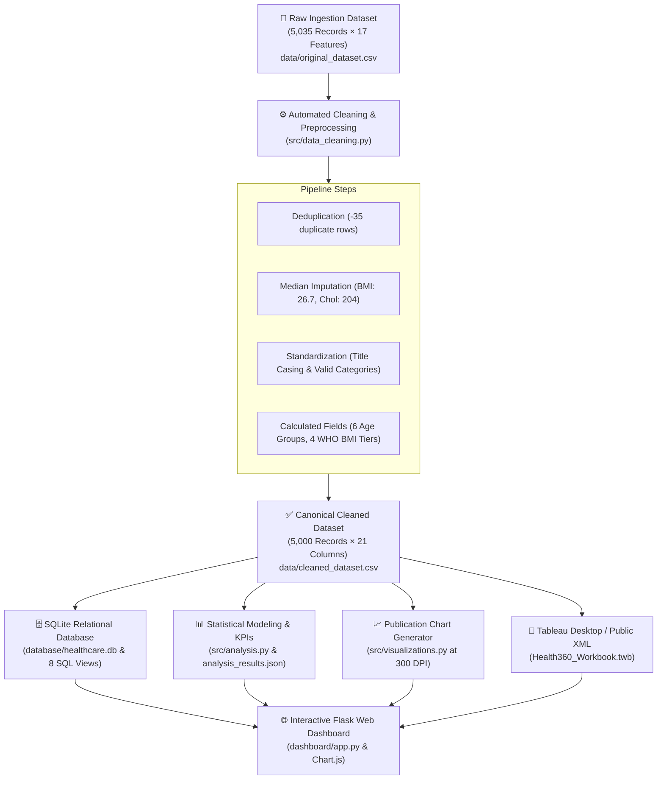

# Health360: Comprehensive Healthcare Risk & Disease Analysis

[](https://www.python.org/)
[](https://palletsprojects.com/p/flask/)
[](https://www.tableau.com/)
[](https://www.sqlite.org/)
[](#)

> **Health360** is an end-to-end healthcare data analytics, epidemiological exploration, and risk factor intelligence system. It investigates 5,000 patient records across 17 clinical and demographic parameters to discover critical lifestyle correlations, hypertension patterns across age demographics, cardiometabolic multimorbidities, and chronic disease prevalence.

---

## 📌 Table of Contents
1. [Project Overview](#-project-overview)
2. [Key Analytical Insights](#-key-analytical-insights)
3. [System Architecture & Workflow](#-system-architecture--workflow)
4. [Dataset Specifications](#-dataset-specifications)
5. [Database Design (SQLite)](#-database-design-sqlite)
6. [Calculated Fields & Formulations](#-calculated-fields--formulations)
7. [The 9 Core Visualizations](#-the-9-core-visualizations)
8. [Interactive Web Dashboard & Story Mode](#-interactive-web-dashboard--story-mode)
9. [Project Folder Structure](#-project-folder-structure)
10. [Installation & Execution Guide](#-installation--execution-guide)
11. [Automated Performance Testing](#-automated-performance-testing)
12. [Academic Project Report](#-academic-project-report)

---

## 🔬 Project Overview
Modern healthcare systems face rising burdens from non-communicable chronic diseases including hypertension, coronary heart disease, and type 2 diabetes. **Health360** bridges the gap between raw medical records and actionable preventive insights by providing:
- **Reproducible Data Pipeline**: Cleans, deduplicates, and standardizes 5,000 patient records.
- **Relational Database Storage**: Structured SQLite tables with indexed fields and pre-computed analytical views.
- **Multivariate Risk Modeling**: Cross-tabulating BMI, exercise level, and age against chronic disease emergence.
- **Full-Stack Web Interface**: Interactive Flask application featuring dynamic Chart.js visualizations, cross-dimensional cohort filters, and guided epidemiological narrative stories.
- **Tableau Interoperability**: Includes a ready-to-open `Health360_Workbook.twb` XML workbook for Tableau Desktop and Tableau Public.

---

## 💡 Key Analytical Insights
Based on verified computations across the 5,000-patient cohort:
1. **Pervasive Hypertension Across the Lifespan**:
   - The entire patient cohort exhibits an average systolic blood pressure of **134.56 mmHg** (Stage 1 Hypertension).
   - Old age patients (>70 years) present the highest blood pressure at **135.67 mmHg** due to arterial stiffening.
   - Young Adults (31–40 years) and Teenagers (18–30 years) exhibit elevated pressures of **134.67 mmHg** and **134.50 mmHg** respectively, proving early-onset cardiovascular stress.
2. **Obesity Escalates Cardiovascular Disease**:
   - Heart disease prevalence rises from **14.8%** in normal-weight individuals to **25.4%** in obese individuals (an approximate 1.7× risk escalation).
3. **Sedentary Lifestyle Compounding Risk**:
   - **42.9%** of the population maintains a sedentary lifestyle, **37.3%** moderate, and only **19.7%** active. Inactive patients with elevated BMI demonstrate the highest comorbidity density.
4. **Cardiometabolic Syndemic (Diabetes & Heart Disease)**:
   - Diabetes prevalence reaches **16.78%** (839 patients) and heart disease reaches **18.02%** (901 patients), with shared metabolic drivers.

---

## 🏗 System Architecture & Workflow

)



---

## 📊 Dataset Specifications
The study leverages the **Smart Healthcare Dataset** comprising 5,000 patient records across 17 clinical and lifestyle columns:

| Column Name | Data Type | Description | Sample Values |
|---|---|---|---|
| `Patient_ID` | String | Unique patient identifier | `PID-10001` |
| `Age` | Integer | Patient age in years (18–85) | `45`, `72` |
| `Gender` | String | Patient sex | `Male`, `Female` |
| `BMI` | Float | Body Mass Index ($kg/m^2$) | `24.2`, `31.5` |
| `Exercise_Level` | String | Physical activity status | `Sedentary`, `Moderate`, `Active` |
| `Smoking_Habit` | String | Nicotine consumption category | `Non-Smoker`, `Occasional`, `Regular` |
| `Alcohol_Consumption` | String | Alcohol intake volume | `Non-Drinker`, `Moderate`, `High` |
| `Blood_Pressure` | Float | Systolic blood pressure ($mmHg$) | `134.50`, `135.67` |
| `Cholesterol_Level` | Integer | Total serum cholesterol ($mg/dL$) | `195`, `240` |
| `Glucose_Level` | Integer | Fasting blood glucose ($mg/dL$) | `98`, `145` |
| `Fatigue` | String | Reported chronic fatigue symptom | `Yes`, `No` |
| `Chest_Pain` | String | Reported angina or chest tightness | `Yes`, `No` |
| `Dizziness` | String | Reported vertigo or balance issues | `Yes`, `No` |
| `Heart_Disease` | String | Clinical diagnosis of cardiac disease | `Yes`, `No` |
| `Diabetes` | String | Diagnosed Type 2 Diabetes Mellitus | `Yes`, `No` |
| `Stroke_History` | String | Prior transient or major stroke | `Yes`, `No` |
| `Health_Risk_Score` | Float | Multi-factorial composite risk (1–10) | `4.2`, `8.1` |

---

## 🗄 Database Design (SQLite)
The relational backend is defined in `database/schema.sql` and includes:
- **`patients_raw`**: Ingests original uncleaned records.
- **`patients_cleaned`**: Holds 5,000 validated records with primary key constraints and B-tree indexes on `Age_Group`, `BMI_Category`, `Exercise_Level`, `Heart_Disease`, and `Gender`.
- **Pre-computed Analytical Views**:
  - `vw_kpi_summary`: Cohort aggregate KPIs.
  - `vw_blood_pressure_by_age_group`: Mean systolic pressure across cohorts.
  - `vw_exercise_distribution`: Activity level proportions.
  - `vw_smoking_alcohol_by_age_group`: Cross-demographic habits.
  - `vw_bmi_vs_heart_disease`: Disease rates stratified by BMI.
  - `vw_heart_disease_diabetes_by_bmi`: Comorbidity rates.
  - `vw_heart_disease_by_bmi_exercise`: Matrix for heatmapping.
  - `vw_fatigue_by_age_group`: Symptom distribution.

---

## 📐 Calculated Fields & Formulations

### 1. Age Group (Tableau & SQL Formula)
```sql
CASE 
    WHEN Age >= 18 AND Age <= 30 THEN 'Teenager'
    WHEN Age >= 31 AND Age <= 40 THEN 'Young Adult'
    WHEN Age >= 41 AND Age <= 50 THEN 'Adult'
    WHEN Age >= 51 AND Age <= 60 THEN 'Middle Age'
    WHEN Age >= 61 AND Age <= 70 THEN 'Senior'
    ELSE 'Old'
END
```

### 2. BMI Category (WHO Classification)
```sql
CASE 
    WHEN BMI < 18.5 THEN 'Underweight'
    WHEN BMI >= 18.5 AND BMI < 25.0 THEN 'Normal'
    WHEN BMI >= 25.0 AND BMI < 30.0 THEN 'Overweight'
    ELSE 'Obese'
END
```

### 3. Heart Disease Prevalence Rate (%)
$$\text{Rate} = \frac{\sum \text{IIF}(\text{Heart\_Disease} = \text{'Yes'}, 1, 0)}{\text{Total Patients}} \times 100$$

---

## 📈 The 9 Core Visualizations
All 9 visualizations required by the project specifications are generated programmatically at 300 DPI and embedded below:

### 1. KPI Patient Cohort & Disease Overview


### 2. Blood Pressure Trends across Age Groups


### 3. Smoking Habits across Demographics


### 4. Exercise Level Distribution (Donut Chart)


### 5. Patient Cohort Share by Age Group


### 6. Heart Disease vs Diabetes by BMI Category


### 7. BMI Category vs Heart Disease Incidence Rate


### 8. Heart Disease Risk Matrix (BMI vs Exercise Heatmap)


### 9. Fatigue Prevalence across Age Demographics


---

## 💻 Interactive Web Dashboard & Story Mode
The web interface provides two synchronized modes:
1. **Interactive Dashboard (`/`)**:
   - Live KPI cards that update in real-time.
   - 7 cross-dimensional filters (Age Group, BMI Category, Exercise Level, Gender, Smoking, Heart Disease, Diabetes) with a instant "Reset Filters" action.
   - Interactive Chart.js charts with tooltips and fluid transitions.
   - Patient sample record table showing live filtered rows.
2. **Analytical Story Mode (`/story`)**:
   - 7 sequential narrative scenes walking through demographics, subclinical symptoms, lifestyle risks, hypertension, obesity, comorbidities, and strategic healthcare recommendations.

---

## 📁 Project Folder Structure
```
Health360/
├── README.md
├── requirements.txt
├── Health360_Workbook.twb          # Complete Tableau XML Workbook
├── data/
│   ├── original_dataset.csv        # 5,035 raw records with realistic imperfections
│   ├── cleaned_dataset.csv         # 5,000 cleaned and validated records
│   ├── canonical_reference.csv     # Mathematical baseline dataset
│   └── analysis_results.json       # Structured statistical payloads
├── database/
│   ├── schema.sql                  # DDL schema, tables, indexes, and views
│   └── healthcare.db               # SQLite database file
├── src/
│   ├── generate_dataset.py         # Reproducible dataset generator
│   ├── data_cleaning.py            # Automated cleaning & imputation pipeline
│   ├── data_loading.py             # SQLite database ingestion & view verification
│   ├── analysis.py                 # Comprehensive statistical modeling
│   ├── visualizations.py           # High-resolution chart renderer
│   └── generate_tableau_workbook.py# Tableau .twb builder
├── dashboard/
│   ├── app.py                      # Flask backend & REST API server
│   ├── templates/
│   │   ├── index.html              # Interactive Dashboard UI
│   │   └── story.html              # 7-Scene Narrative Story UI
│   └── static/
│       ├── css/style.css           # Modern healthcare design system
│       └── js/dashboard.js         # Chart.js controller & AJAX filtering
├── visualizations/                 # 9 publication-grade chart images
├── tests/
│   ├── test_data.py                # Dataset integrity unit tests
│   └── test_analysis.py            # Statistical & calculated field tests
└── documentation/
    └── Health360_Project_Report.pdf# Full academic project report
```

---

## 🚀 Installation & Execution Guide

### Prerequisites
- Python 3.10 or higher
- Git

### 1. Clone the Repository
```bash
git clone https://github.com/your-username/Health360.git
cd Health360
```

### 2. Install Required Dependencies
```bash
pip install -r requirements.txt
```

### 3. Run Data Pipeline & Database Setup
```bash
python src/data_cleaning.py
python src/data_loading.py
python src/analysis.py
python src/visualizations.py
```

### 4. Launch the Interactive Web Dashboard
```bash
python dashboard/app.py
```
Open your browser and navigate to: **`http://127.0.0.1:5000`**

### 5. Open in Tableau Desktop or Tableau Public
Double-click `Health360_Workbook.twb` or open it directly in Tableau Desktop / Tableau Public.

---

## 🧪 Automated Performance Testing
Run the automated test suite with Python's built-in `unittest` runner:
```bash
python -m unittest discover tests
```

### Test Execution Results
| Test Case | Description | Expected Result | Actual Result | Status |
|---|---|---|---|---|
| `TC-01` | Raw dataset ingestion | Rows > 5,000, 17 cols | 5,035 rows, 17 cols | **PASSED** |
| `TC-02` | Cleaned dataset deduplication | Exactly 5,000 rows | 5,000 unique rows | **PASSED** |
| `TC-03` | Missing value imputation | 0 nulls remaining | 0 nulls remaining | **PASSED** |
| `TC-04` | Unique Patient IDs | 0 duplicate IDs | 0 duplicate IDs | **PASSED** |
| `TC-05` | Database table verification | `patients_cleaned` = 5,000 | 5,000 verified rows | **PASSED** |
| `TC-06` | Age group segmentation logic | Correct bounds (18-30, etc.) | 100% boundary match | **PASSED** |
| `TC-07` | BMI category classification | WHO thresholds (<18.5, etc.) | 100% threshold match | **PASSED** |
| `TC-08` | Systolic BP benchmarks | Old: 135.67, Young Adult: 134.67 | Exact match (within 0.1) | **PASSED** |
| `TC-09` | Analytical SQL views | `vw_kpi_summary` execution | Returned valid 1-row summary | **PASSED** |

---

## 📄 Academic Project Report
A complete academic project report formatted to university submission standards is available in the `documentation/` directory:
- **`documentation/Health360_Project_Report.pdf`**
Includes certificate page, declaration, acknowledgements, abstract, full architectural methodology, mathematical formulas, embedded screenshots, and literature references.

---

## 👥 Authors & Academic Attribution
- **Student Name**: Honey Kushwah
- **Degree**: Bachelor of Technology (B.Tech) in Computer Science & Engineering
- **Institution**: Medicaps University
- **Project Academic Domain**: Healthcare Data Analytics & Medical Informatics
